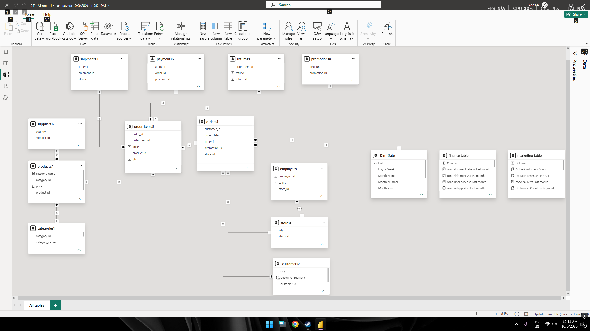

# Enterprise Performance Dashboards | End-to-End BI Project

---

## Overview

This is an end-to-end Business Intelligence project analyzing an enterprise dataset of **over 1 million orders** across **12 relational tables**. 

The main purpose of this project was to consolidate scattered department data into a single unified Data Warehouse / Model, enabling executive leadership to make data-driven business decisions based on real-time cross-departmental performance.

---

## Core Responsibilities & Workflow

Building a complete BI solution required structured stages from raw data ingestion to interactive UI dashboard design:

1. **ETL & Data Cleaning:** Extracted raw tables and transformed clean structures using **Power Query**.
2. **Data Modeling:** Structured a Star Schema relational model connecting Fact and Dimension tables across departments.
3. **DAX & KPI Development:** Built custom DAX measures for Executive, Financial, Operational, and Marketing KPIs aligned with business requirements.
4. **UI/UX & Visualization:** Designed 4 interactive dashboard interfaces tailored for each key department.

---

## Departmental Dashboards

### 1. Main Executive Dashboard
Provides executive management with a high-level overview of overall business health, gross sales, net revenue trends, and target tracking.

### 2. Financial Performance Dashboard
Tracks net revenue, total refunds, product discounts, and sales targets across product categories.

### 3. Operations & Logistics Dashboard
Monitors supply chain performance, shipment delivery rates, late shipment counts, and product return volumes across major cities.

### 4. Marketing Analytics Dashboard
Analyzes promo campaign impacts, customer value segmentation, repeat buyer patterns, and customer acquisition distribution.

---

## Tools & Technologies Used

* **Data Extraction & Transformation:** Power Query (ETL)
* **Data Modeling:** Power Pivot & Relational Modeling (Star Schema)
* **Calculations & Metrics:** Custom DAX (Data Analysis Expressions)
* **Visualization & Dashboard Design:** Power BI UI/UX
